# 4. مخطط قاعدة البيانات (ERD)

قواعد عامة:
- المعرّفات `uuid` (عشوائية آمنة) إلا حيث يلزم تسلسل (الأحداث، الرسائل بها عمود seq لكل محادثة).
- **ممنوع منعًا باتًا** تخزين: مفاتيح خاصة، Recovery Keys، نصوص مفكوكة، مفاتيح فك غير مغلفة، مفاتيح MLS الخام، محتوى المرفقات الأصلي. قائمة فحص ثابتة في `07-test-plan.md` (SEC-09).
- كل جدول له `created_at` (و`updated_at` عند الحاجة)؛ محذوف لأغراض العرض فقط.
- جميع ciphertext تُخزن `bytea` مع `algorithm` و`version` صريحين.

## 4.1 مخطط العلاقات (Mermaid)

```mermaid
erDiagram
    ORGANIZATIONS ||--o{ INSTITUTES : "يعتمد"
    INSTITUTES ||--o{ BRANCHES : "تملك"
    INSTITUTES ||--o{ DEPARTMENTS : "تضم"
    BRANCHES ||--o{ DEPARTMENTS : "يستضيف"
    DEPARTMENTS ||--o{ DEPARTMENTS : "فرعي من"
    USERS ||--o{ EMPLOYEE_MEMBERSHIPS : "عضو"
    INSTITUTES ||--o{ EMPLOYEE_MEMBERSHIPS : ""
    BRANCHES ||--o{ EMPLOYEE_MEMBERSHIPS : ""
    DEPARTMENTS ||--o{ EMPLOYEE_MEMBERSHIPS : ""
    ROLES ||--o{ ROLE_PERMISSIONS : ""
    PERMISSIONS ||--o{ ROLE_PERMISSIONS : ""
    ROLES ||--o{ USER_ROLE_ASSIGNMENTS : ""
    USERS ||--o{ USER_ROLE_ASSIGNMENTS : ""
    USERS ||--o{ USER_SESSIONS : ""
    TRUSTED_DEVICES ||--o{ USER_SESSIONS : "ربط"
    USERS ||--|| USER_CRYPTO_IDENTITIES : "هوية واحدة"
    USERS ||--o{ TRUSTED_DEVICES : "أجهزة"
    TRUSTED_DEVICES ||--o{ DEVICE_KEY_BUNDLES : "KeyPackages"
    TRUSTED_DEVICES ||--o{ CRYPTO_SESSIONS : "حالة توصيل"
    USERS ||--o{ ENCRYPTED_KEY_BACKUPS : "نسخ استعادة"

    USERS ||--o{ CORRESPONDENCES : "أرسل"
    CORRESPONDENCES ||--o{ CORRESPONDENCE_PARTICIPANTS : ""
    USERS ||--o{ CORRESPONDENCE_PARTICIPANTS : ""
    CORRESPONDENCES ||--o{ CORRESPONDENCE_REPLIES : ""
    CORRESPONDENCES ||--o{ CORRESPONDENCE_FORWARDINGS : ""
    CORRESPONDENCES ||--o{ CORRESPONDENCE_EVENTS : ""
    INSTITUTES ||--o{ REFERENCE_SEQUENCES : ""
    CORRESPONDENCES ||--o{ ENCRYPTED_PAYLOADS : "عنوان/محتوى"

    USERS ||--o{ CONVERSATIONS : "أنشأ"
    CONVERSATIONS ||--o{ CONVERSATION_MEMBERS : ""
    USERS ||--o{ CONVERSATION_MEMBERS : ""
    CONVERSATIONS ||--o{ MESSAGES : ""
    USERS ||--o{ MESSAGES : "أرسل"
    MESSAGES ||--o{ MESSAGE_REACTIONS : ""
    CONVERSATIONS ||--o{ GROUP_CRYPTO_EPOCHS : "أجيال"
    MESSAGES ||--o{ MESSAGE_KEY_ENVELOPES : "أغلفة مفاتيح"
    STORED_FILES ||--o{ ENCRYPTED_ATTACHMENTS : ""

    APPROVAL_WORKFLOWS ||--o{ APPROVAL_STEPS : ""
    APPROVAL_WORKFLOWS ||--o{ APPROVAL_REQUESTS : ""
    APPROVAL_REQUESTS ||--o{ APPROVAL_DECISIONS : ""
    APPROVAL_STEPS ||--o{ APPROVAL_DECISIONS : ""

    USERS ||--o{ NOTIFICATIONS : ""
    USERS ||--|| NOTIFICATION_PREFERENCES : ""
    USERS ||--o{ AUDIT_LOGS : "نفّذ"
```

## 4.2 الوحدات والجداول التفصيلية

### أ) التنظيمي

**organizations**: `id uuid PK`، `name`، `slug unique`، `is_active`.

**institutes**: `id uuid PK`، `organization FK`، `name`، `code unique` (يُستخدم في الرقم المرجعي)، `is_active`.

**branches**: `id uuid PK`، `institute FK`، `name`، `code`، `city`، `unique(institute, code)`، `is_active`.

**departments**: `id uuid PK`، `institute FK`، `branch FK NULL` (قسم على مستوى معهد أو فرع)، `parent FK→departments NULL` (هيكل شجري)، `name`، `code`، `unique(institute, code)`.

**employee_memberships**: `id uuid PK`، `user FK`، `institute FK`، `branch FK NULL`، `department FK NULL`، `job_title`، `is_primary bool` (جهة واحدة رئيسية)، `employment_type` (دوام/تطوع..)، `started_on`، `ended_on NULL`.
- قيود: `CHECK (branch IS NULL OR branch.institute = institute)` عبر تحقق تطبيقي + trigger؛ فهرس `(user, is_primary)` جزئي فريد؛ فهرس `(department)`.

### ب) الحسابات

**users**: `id uuid PK`، `username unique`، `password_hash` (Argon2id)، `first_name`، `last_name`، `full_name generated` (مخزن + index للبحث الإداري)، `phone`، `optional_email unique NULL`، `is_active`، `must_change_password bool`، `mfa_enabled bool`، `mfa_method` (totp/webauthn)، `mfa_secret_ciphertext bytea NULL` (مشفر بمفتاح خادم/KMS — ليس E2EE لأنه خاص بالدخول فقط)، `password_changed_at`، `created_at`، `updated_at`، `last_login_at`، `deactivated_at NULL`، `deactivation_reason`.

**user_sessions**: `id uuid PK`، `user FK`، `device FK→trusted_devices NULL`، `refresh_token_hash unique`، `ip inet`، `user_agent`، `created_at`، `expires_at`، `revoked_at NULL`، `revoked_reason`.
- فهرس `(user, revoked_at)`؛ مهمة التنظيف تحذف المنتهية.

**trusted_devices**: `id uuid PK`، `user FK`، `device_label` (مثل «Chrome — مكتب الرياض»)، `platform`، `app_version`، `identity_sign_pub bytea` (Ed25519، `unique`)، `kem_pub bytea` (X25519/HPKE) — **لا يخزن أي مفتاح خاص**، `status` (pending/active/approved/revoked/retired)، `approved_by_device FK→trusted_devices NULL`، `approved_at`، `last_seen_at`، `revoked_at NULL`، `created_at`.
- فهرس `(user, status)`.

**user_crypto_identities**: `user FK PK/unique`، `identity_sign_pub bytea` (Ed25519)، `algorithm` مثل `ed25519+x25519`، `created_at`، `rotated_at NULL`، `superseded_by_hash bytea NULL` (سلسلة التدوير)، `bootstrap_signature bytea` (توقيع أول جهاز على الهوية لإغلاق حلقة البداية).

### ج) التخويل

**roles**: `id uuid PK`، `code unique` (مثل `branch_manager`)، `name_ar`، `description`، `is_system bool`.

**permissions**: `id uuid PK`، `code unique`، `name_ar`، `description`، `category` (org/accounts/correspondence/chat/approvals/archive/reports/audit).

**role_permissions**: `role FK`، `permission FK`، `PK(role, permission)`.

**user_role_assignments**: `id uuid PK`، `user FK`، `role FK`، `institute FK NULL`، `branch FK NULL`، `department FK NULL` (النطاق: كلها NULL = عام/مركزي)؛ `granted_by FK→users`، `granted_at`، `expires_at NULL`.
- تحقق تطبيقي: اتساق النطاق (branch تابع لـ institute إلخ).

### د) المراسلات الرسمية

**correspondences**: `id uuid PK`، `reference_number` (مثل `FAO-RYD-2026-000125`)، `sender FK→users`، `subject_payload FK→encrypted_payloads` (ciphertext)، `body_payload FK→encrypted_payloads` (ciphertext)، `priority` (low/normal/high/urgent)، `classification` (normal / confidential / institutional_archive_eligible)، `status` (draft/sent/delivered/read/replied/closed) — الحالة بيانات وصفية مشروعة، `thread_root FK→correspondences NULL`، `reply_to FK→correspondences NULL`، `due_date NULL`، `created_at`، `sent_at NULL`، `immutable_after_sent bool` (يُفرض بمنع UPDATE عبر طبقة الخدمة + اختبار).
- `unique(reference_number)`؛ فهارس `(sender, sent_at desc)`، `(thread_root)`، `(status, due_date)`.

**correspondence_participants**: `id uuid PK`، `correspondence FK`، `user FK`، `kind` (to/cc/bcc) — BCC لا يظهر لغير أصحابه (انظر 05)، `added_via` (original/forward) ، `read_at NULL`، `is_institutional_archive_recipient bool` (المستلم المؤسسي المعلن)، `hidden_from_others bool DEFAULT false` (يُستخدم لـ BCC).
- `unique(correspondence, user, kind)` جزئي؛ فهرس `(user, kind, read_at)` لصندوق الوارد.

**correspondence_replies**: `id uuid PK`، `parent FK→correspondences`، `reply FK→correspondences` (المراسلة الفعلية الجديدة)؛ `unique(parent, reply)`.

**correspondence_forwardings**: `id uuid PK`، `source FK→correspondences`، `forwarded_by FK→users`، `new_correspondence FK→correspondences` (التي أُنشئت للمُحال إليه)، `note_payload FK→encrypted_payloads NULL` (ciphertext)، `grant_envelope FK→message_key_envelopes NULL` (غلاف إعادة تشفير المفتاح للمستلم الجديد — لا مفتاح خام)، `created_at`.

**correspondence_events**: `id uuid PK`، `correspondence FK`، `actor FK→users NULL` (system = NULL)؛ `event_type` (created/sent/delivered/read/replied/forwarded/key_shared/milestone)، `metadata jsonb` (معرّفات وأرقام فقط — لا محتوى)، `created_at`. فهرس `(correspondence, created_at)`.

**reference_sequences**: `institute FK`، `year int`، `last_seq int`، `PK(institute, year)`. التوليد داخل معاملة `SELECT ... FOR UPDATE`؛ صيغة الرقم `{institute}-{branch?}-{year}-{seq:06d}`.

### هـ) المحادثات

**conversations**: `id uuid PK`، `type` (dm/group/channel_dept/channel_branch/channel_institute/cross_branch)؛ `org_unit` مرجع مزدوج: `department/branch/institute FK NULL` (للقنوات الرسمية)؛ `title_plain NULL` (القنوات الرسمية فقط — اسمها بيانات تنظيمية)؛ `title_payload FK→encrypted_payloads NULL` (المجموعات/الخاصة)؛ `mls_group_id bytea unique` (معرّف المجموعة)، `current_epoch int`، `created_by FK→users`، `created_at`، `archived_at NULL`.

**conversation_members**: `conversation FK`، `user FK`، `member_role` (member/admin) ، `added_by FK→users`، `joined_at`، `removed_at NULL`، `last_read_seq bigint`؛ `PK(conversation, user)`. فهرس `(user, removed_at)`.

**messages**: `id uuid PK`، `conversation FK`، `sender FK→users`، `sender_device FK→trusted_devices`، `seq bigint` (متسلسل لكل محادثة — يفرضه counter ذري لكل محادثة)، `mls_epoch int` (للتدقيق)، `ciphertext bytea`، `content_type` (text/attachment/system) — **النظام فقط قد يكون وصفًا غير حساس**، `reply_to FK→messages NULL`، `created_at`، `edited_at NULL`، `deleted_tombstone bool`.
- `unique(conversation, seq)`؛ فهرس `(conversation, seq desc)`.

**message_reactions**: `message FK`، `user FK`، `emoji` (shortcode محدد القائمة)؛ `PK(message, user, emoji)`، `created_at`.

### و) التشفير

**device_key_bundles**: `id uuid PK`، `device FK→trusted_devices`، `keypackage bytea` (توقيعها يُتحقق من سلسلة الثقة)، `keypackage_hash bytea unique` (منع إعادة الاستخدام) ، `uploaded_at`، `consumed_at NULL` (عند استخدامها في Welcome)، `expires_at`.
- فهرس `(device, consumed_at)` للاستعلام السريع عن المتاح.

**crypto_sessions**: `id uuid PK`، `device FK`، `conversation FK→conversations NULL` (أو مراسلة)، `epoch int`، `last_processed_seq bigint`، `state_note` (وصف عام فقط)، `updated_at`؛ `unique(device, conversation)`. — **حالة توصيل bookkeeping فقط؛ لا أسرار**.

**encrypted_payloads**: `id uuid PK`، `algorithm` (مثل `aes-256-gcm`)، `version int`، `ciphertext bytea`، `nonce bytea`، `aad_hash bytea` (للتحقق من سياق الربط)، `created_at`. يُشار إليه من المراسلات/المرفقات/العناوين.

**message_key_envelopes**: `id uuid PK`، `owner_type` (message/attachment/forward_grant/recovery_hint) + `owner_id uuid` (فهرس مركب)؛ `recipient_device FK→trusted_devices`، `envelope_ciphertext bytea` (المفتاح المغلف للجهاز)، `algorithm`، `created_at`.

**encrypted_key_backups**: `id uuid PK`، `user FK`، `version int`، `kdf` (hkdf/argon2id) + `kdf_params jsonb` + `salt bytea`، `ciphertext bytea`، `uploaded_from_device FK→trusted_devices`، `created_at`؛ `unique(user, version)`. — لا يوجد عمود مفتاح فك.

**group_crypto_epochs**: `id uuid PK`، `conversation FK`، `epoch int`، `commit_hash bytea`، `committed_by_device FK→trusted_devices`، `member_count int`، `started_at`، `ended_at NULL`؛ `unique(conversation, epoch)`.

**key_verification_events**: `id uuid PK`، `verifier_device FK`، `verified_device FK`، `method` (sas/qr) ، `fingerprint_hash bytea` (تجزئة البصمة المتفق عليها)، `result` (success/failed)؛ `created_at`.

**key_transparency_events**: `id bigserial PK` (التسلسل الكلي seq)، `user FK NULL`، `device FK NULL`، `event_type` (identity_created/identity_rotated/device_added/device_approved/device_revoked/key_rotated)؛ `prev_hash bytea`، `entry_hash bytea`، `payload jsonb` (تجزئات المفاتيح العامة فقط)، `log_signature bytea`؛ `created_at`. — السلسلة تُتحقق دوريًا بفحص `hash(prev_hash || payload)`؛ أي كسر يوقف التحقق ويُنبه.

### ز) الملفات

**stored_files**: `id uuid PK`، `storage_key` (مسار/مفتاح التخزين) ، `ciphertext_size bigint`، `ciphertext_sha256 bytea` (للكشف عن التبديل)، `uploader FK→users`، `uploaded_at`، `deleted_at NULL`. — لا content_type واضح إلا hint عام غير حساس.

**encrypted_attachments**: `id uuid PK`، `stored_file FK`، `correspondence FK NULL`، `message FK NULL`، `exactly one of them NOT NULL` (تحقق)، `filename_payload FK→encrypted_payloads` (الاسم مشفر)، `metadata_payload FK→encrypted_payloads NULL` (حجم أصلي/نوع داخلي مشفر)، `algorithm`، `created_at`.

### ح) الموافقات

**approval_workflows**: `id uuid PK`، `name`، `scope_unit` (معهد/فرع/قسم FK NULL = عام)، `definition jsonb` (مخطط: خطوات متسلسلة/متوازية، من المُعتمدون: دور+نطاق أو مستخدم محدد، مهلة، قواعد تفويض)؛ `version int`، `is_active`، `created_by`.

**approval_steps**: `id uuid PK`، `workflow FK`، `step_order int`، `step_type` (sequential_any/parallel_all/parallel_any)؛ `approver_selector jsonb` (مثل `{"role":"branch_manager","scope":"sender_branch"}` أو `{"user":"<uuid>"}`)؛ `timeout_hours int`؛ `unique(workflow, step_order)`.

**approval_requests**: `id uuid PK`، `workflow FK` (لقطة الإصدار `workflow_version`)، `subject_type` (correspondence/announcement/other) + `subject_id uuid`، `status` (pending/approved/rejected/returned/completed/cancelled)؛ `current_step_order int`، `requested_by FK→users`، `created_at`، `completed_at NULL`. فهرس `(status, current_step_order)`.

**approval_decisions**: `id uuid PK`، `request FK`، `step FK`، `approver FK→users`، `approver_device FK→trusted_devices` (القرار يُوقع من الجهاز)، `decision` (approved/rejected/returned)؛ `decision_payload bytea` (كائن القرار الموقع: `{request_id, content_hash, decision, timestamp}` موقّع بمفتاح جهاز المعتمد — **توقيع قرار تشفيري للنزاهة وليس توقيعًا نظاميًا**)؛ `comment_payload FK→encrypted_payloads NULL`، `decided_at`؛ `unique(request, step, approver)` (منع الاعتماد المكرر؛ التفويض صف مستقل `delegated_from FK→approval_decisions NULL` أو جدول تفويضات مستقبلي).

### ط) الإشعارات والتدقيق

**notifications**: `id uuid PK`، `user FK`، `kind` (new_correspondence/new_message/announcement/approval/announcement_ack/device_alert)؛ `title_generic` (نص عام مثل «لديك مراسلة جديدة» — لا محتوى)، `ref_type` + `ref_id uuid` (للفتح السريع)، `created_at`، `read_at NULL`. فهرس `(user, read_at)`.

**notification_preferences**: `user FK PK`، `prefs jsonb` (قنوات: ws/email/push لكل نوع)، `updated_at`.

**outbox_events**: `id uuid PK`، `kind`، `payload jsonb` (معرّفات فقط)، `routing jsonb` (مستخدمون/محادثة)؛ `status` (pending/sent/failed) ، `attempts int`، `next_attempt_at`، `created_at`، `sent_at NULL`. فهرس `(status, next_attempt_at)`.

**audit_logs**: `id bigserial PK`، `actor FK→users NULL`، `actor_device FK NULL`، `action` (login/logout/password_changed/permission_granted/device_added/device_revoked/key_event/correspondence_sent/forward/approval_decided/restore_attempt/unauthorized_access_denied...)؛ `target_type` + `target_id`، `org_scope` (وحدة) ، `ip inet`، `user_agent`، `metadata jsonb` (بلا أسرار)؛ `created_at`. — **جدول append-only**: صلاحية DB بلا UPDATE/DELETE على الجدول؛ فهارس `(actor, created_at)`، `(action, created_at)`، `(target_type, target_id)`.

## 4.3 ملاحظات تشغيلية على المخطط

1. **BCC:** يُخزّن `hidden_from_others=true`؛ واجهات API تعيد قائمة المشاركين بعد حذف BCC لغير أصحابه (انظر 05).
2. **فصل الحالة عن المفتاح:** صلاحية «قراءة» مشتقة من `correspondence_participants`/`conversation_members` الحيّة؛ وصلاحية «فك التشفير» مشتقة من امتلاك الجهاز للأسرار عبر MLS/الأغلفة — الاثنتان ضروريتان ومستقلتان.
3. **immutability بعد الإرسال:** يمنع التعديل على `correspondences`/`messages` بسياسة طبقة خدمة + اختبار تكامل يحاول التعديل مباشرة عبر API.
4. **النسخ الاحتياطي:** كل الجداول أعلاه آمنة افتراضيًا عند تسريبها (بيانات وصفية + ciphertext) باستثناء ما يجب تشفيره بمفتاح خادم: `users.mfa_secret_ciphertext` وسلاسل الربط الحساسة — يُدار بـ KMS وبشكل منفصل عن بيانات E2EE.
